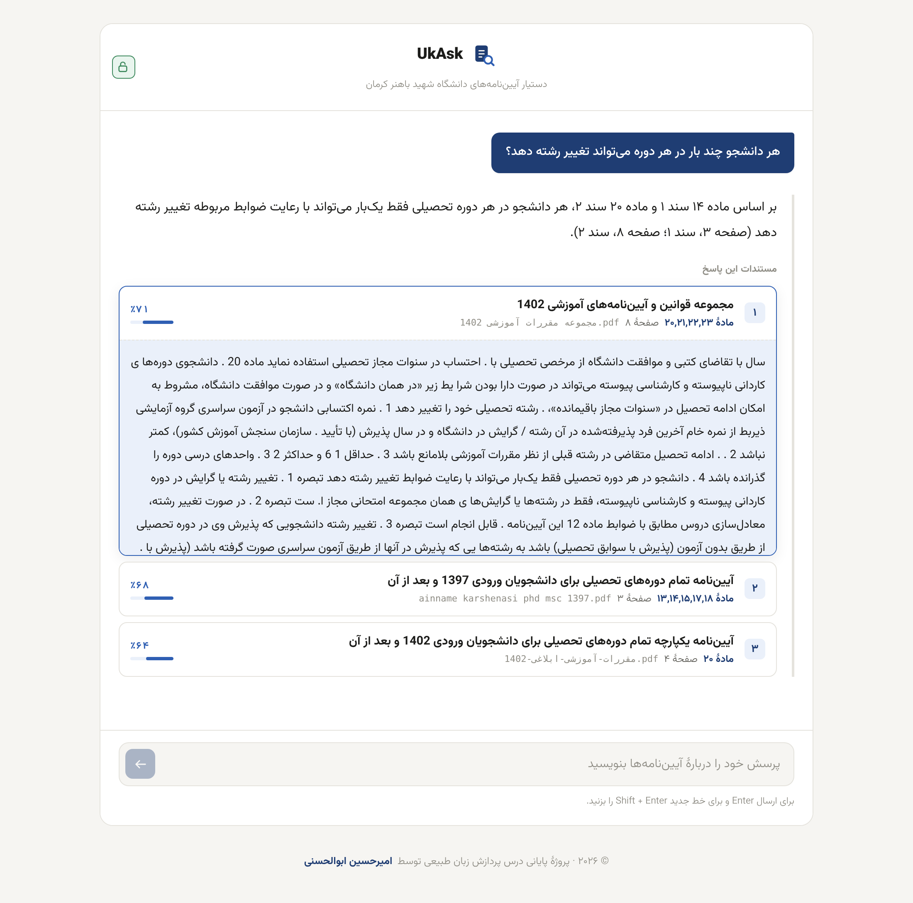
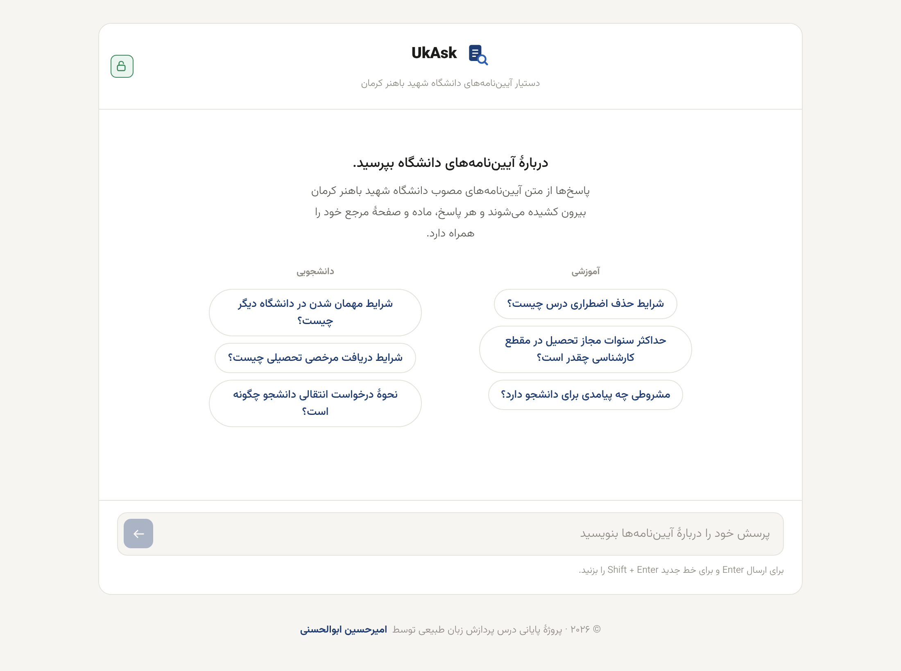
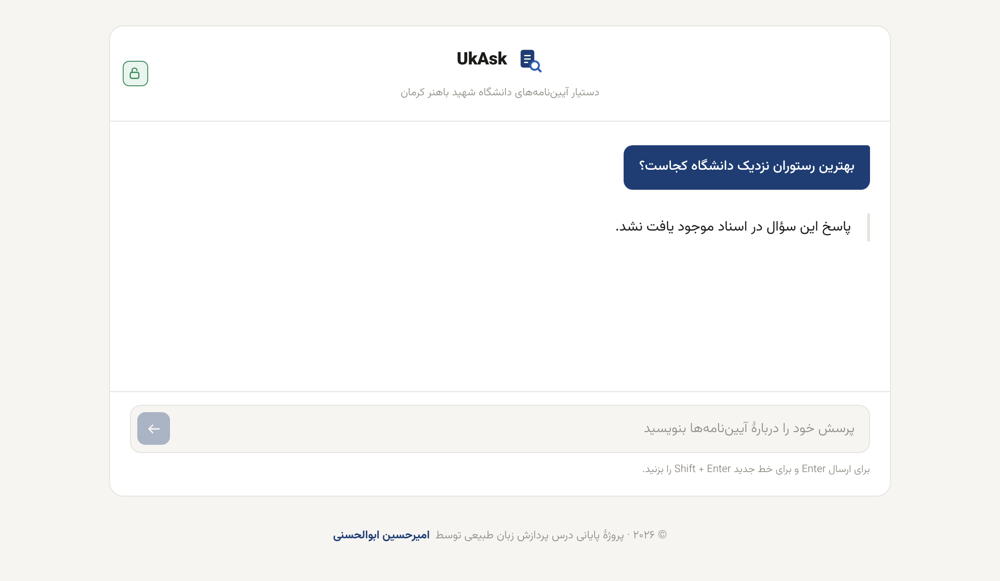
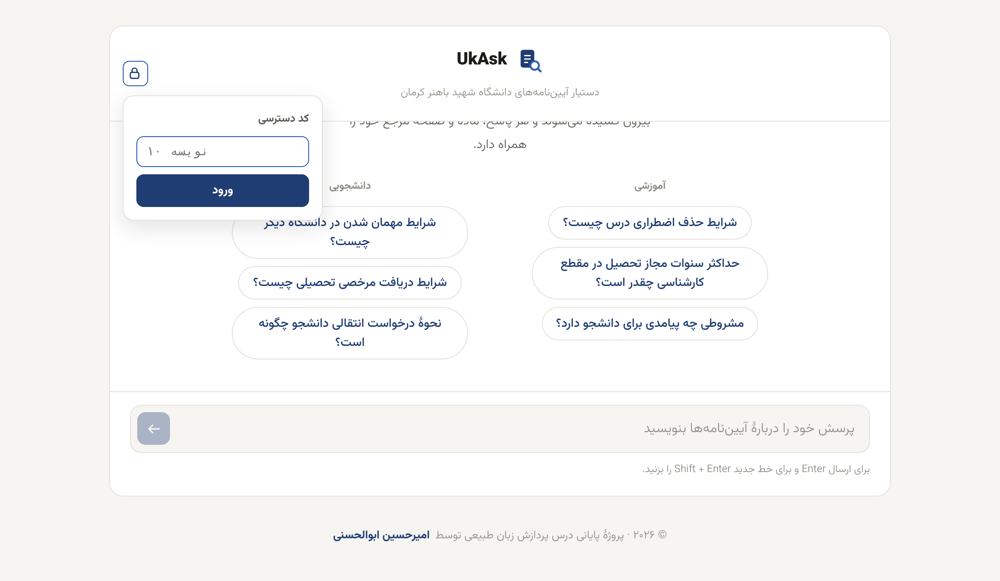
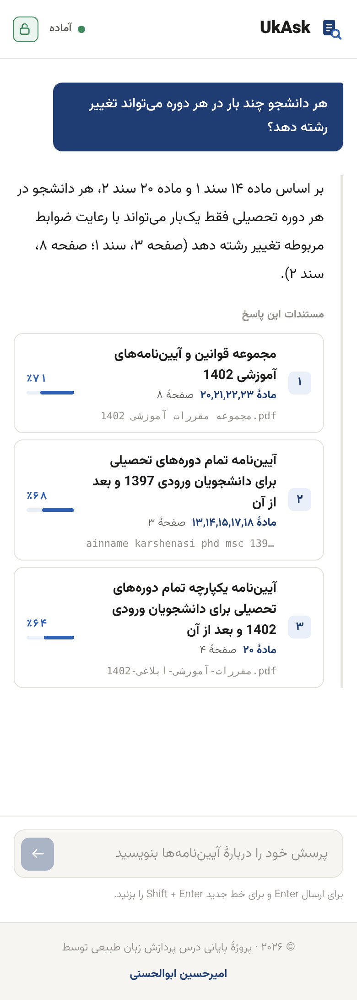
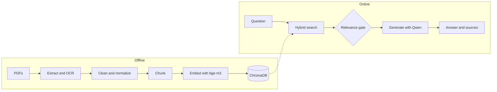
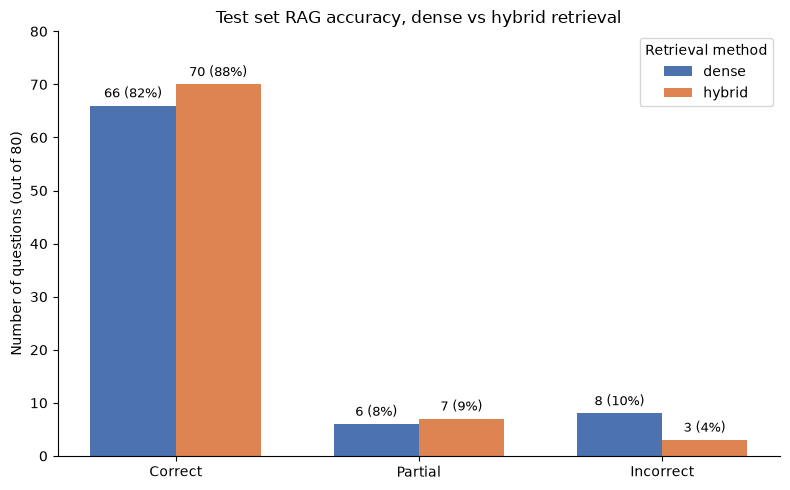
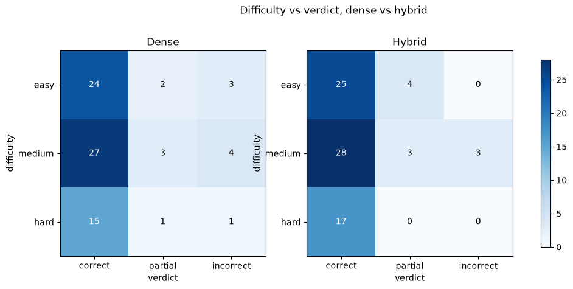
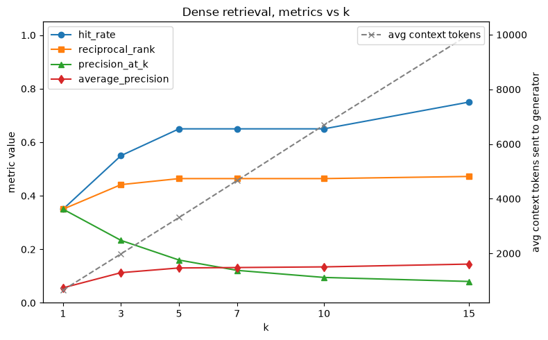
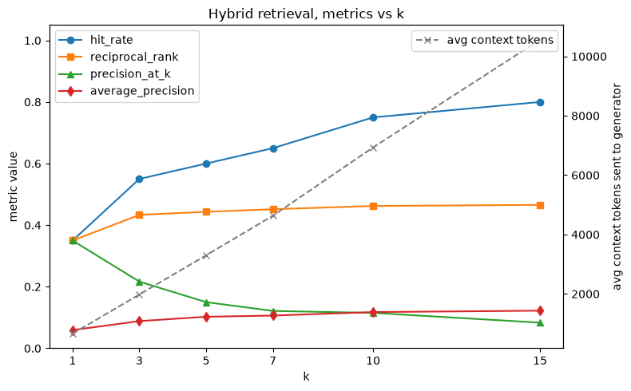

# UkAsk

A Persian question answering assistant for the academic regulations of Shahid Bahonar University of Kerman. Every answer is built from the university's own PDFs and comes with the article and page it was taken from.

<p align="center">
  
</p>

## Screenshots

<table>
  <tr>
    <td width="50%"></td>
    <td width="50%"></td>
  </tr>
  <tr>
    <td align="center"><sub>Start screen with suggested questions</sub></td>
    <td align="center"><sub>Out of scope questions are refused instead of guessed</sub></td>
  </tr>
  <tr>
    <td valign="top"></td>
    <td valign="top" align="center"></td>
  </tr>
  <tr>
    <td align="center"><sub>Access code panel behind the lock icon</sub></td>
    <td align="center"><sub>Mobile layout</sub></td>
  </tr>
</table>

## How it works



| Setting | Value |
| --- | --- |
| Chunking | 300 to 500 tokens, 50 token overlap |
| Embeddings | `BAAI/bge-m3`, run locally |
| Retrieval | Dense and BM25, top 20 each, merged with Reciprocal Rank Fusion, `k=5` |
| Relevance gate | Top cosine similarity must reach 0.52, otherwise the model is never called |
| Generator | `gapgpt-qwen-3.6` through GapGPT |
| Judge for evaluation | `gpt-4o` |

## Results

Evaluated on 100 labeled questions, split into 20 for tuning and 80 for testing. The split is stratified by question type and difficulty, and the test set was only touched after every setting was frozen.

| Test set (80 questions) | Dense | Hybrid |
| --- | :---: | :---: |
| Correct answers | 66 (82%) | **70 (88%)** |
| Partial answers | 6 (8%) | 7 (9%) |
| Incorrect answers | 8 (10%) | **3 (4%)** |
| Retrieval hit rate | 0.425 | **0.512** |
| Mean reciprocal rank | 0.260 | **0.321** |

<p align="center">
  
</p>

<p align="center">
  
</p>

<table>
  <tr>
    <td width="50%"></td>
    <td width="50%"></td>
  </tr>
  <tr>
    <td align="center"><sub>Dense retrieval on the dev set</sub></td>
    <td align="center"><sub>Hybrid retrieval on the dev set</sub></td>
  </tr>
</table>

### What stood out

- Hybrid search cut clearly wrong answers from 8 to 3, even though the small dev set showed no gain at `k=5`.
- Retrieval metrics and answer quality tell different stories. Hard questions hit the labeled article only 18% of the time, yet hybrid answered all 17 of them correctly because the same rule often appears in another document.
- Reciprocal rank stays flat as `k` grows while the hit rate keeps climbing, so the right chunk is found but not pushed up. A re-ranker is the obvious next step.
- Context sent to the generator roughly triples between `k=5` and `k=15`, so a larger `k` comes with a real cost.
- Precision and MAP are treated as secondary, since one question can be answered by several passages and the labels only name one article.

The full reasoning, including the PDF extraction problems (a broken font map, reversed lam-alef letters, repeated headers) and why table extraction ended up disabled, is in the [project report](docs/UkAsk-Report.pdf).

## Quick start

You need Python 3.12 with conda, Node.js 18 or newer, and [Tesseract](https://github.com/tesseract-ocr/tesseract) with the Persian (`fas`) language pack. You also need a [Hugging Face](https://huggingface.co/) token for the embedding model and a [GapGPT](https://gapgpt.app/) key for generation and evaluation.

```bash
conda env create -f environment.yml
conda activate ukask
npm install
npm --prefix frontend install
```

Create a `.env` file in the project root.

```text
HF_TOKEN=your_huggingface_token
GAPGPT_API_KEY=your_gapgpt_key
ACCESS_CODE=pick_a_shared_access_code
SESSION_SECRET=generate_a_long_random_string
```

Point `TESSERACT_CMD` in [pipeline/config.py](pipeline/config.py) at your binary, or set it to `None` if `tesseract` is already on your `PATH`. Any new PDF goes into `data/pdfs/` and needs an entry in `DOCUMENT_MANIFEST` in the same file.

Build the index, then start everything.

```bash
python -m pipeline.build_index
npm run dev
```

The index is rebuilt from scratch on every run, so no stale chunks survive a config change. The API listens on port 8000 and the UI on `http://localhost:5173`, where the lock icon takes your `ACCESS_CODE`. Source PDFs and evaluation data are committed, while the built index in `data/chroma/` is gitignored.

## Project layout

| Folder | Contents |
| --- | --- |
| `pipeline/` | Offline ingestion with extraction, OCR fallback, normalization, chunking, embedding and storage |
| `backend/` | FastAPI service with hybrid retrieval, generation and access code auth |
| `frontend/` | React and Vite chat interface |
| `evaluation/` | Retrieval metrics and the LLM judge |
| `notebooks/` | Exploration and tuning, one notebook per stage |
| `data/` | Source PDFs, the evaluation set and its saved results |

## Evaluation

```python
from evaluation import dataset, retrieval_metrics, rag_metrics
```

Retrieval metrics are free to rerun. Answer correctness calls the judge model and spends real API requests. Worked examples live in `notebooks/03_retrieval tuning.ipynb` and `notebooks/04_answer_correctness.ipynb`. The labeled questions are in `data/eval/evalset.json`, the fixed dev and test split in `data/eval/split.json`, and one JSON per run under `data/eval/results/`.

## License

Released under the [MIT License](LICENSE). Built by Amirhossein Abolhassani as the final project of the Natural Language Processing course.
